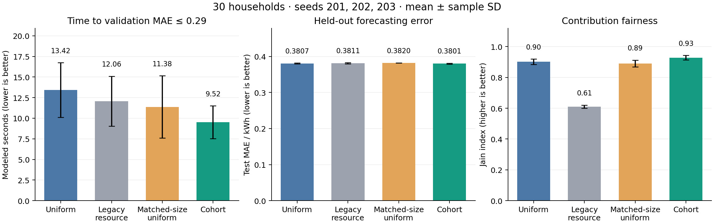
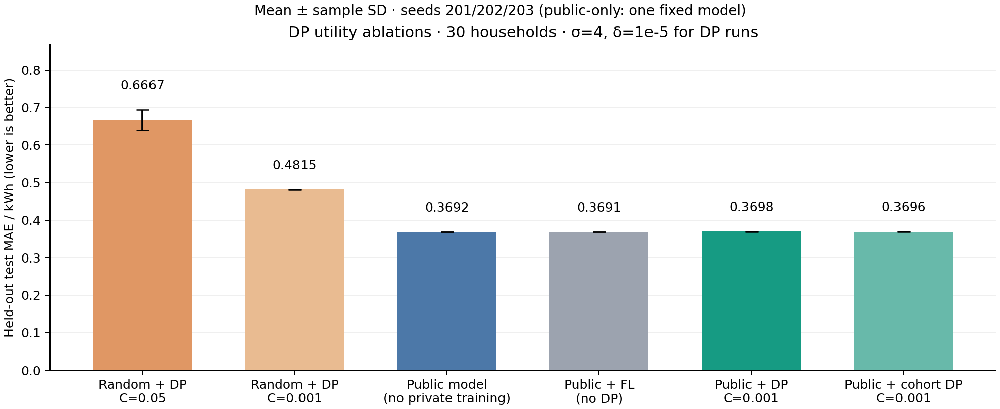

# 第二轮改进：设备档位轮换与公开预训练 DP 微调

日期：2026-11-13。先在验证集使用种子 101 选择设置、102 复核；随后冻结设置，在新的种子 201/202/203 上评估测试集。未按本轮测试结果修改方法或排除种子。测试时间段与前版相同，新增随机种子不意味着新的独立测试数据集。

30 户新调度相对安全均匀 FedAvg，逐种子配对的平均 time-to-target 改善 **28.53%**，测试 MAE 相对变化 **-0.17%**。提案的 20% 加速且 MAE 劣化≤5% 目标：**在当前仿真达到**。
公开预训练后用 C=0.001 进行 DP 微调，相对原 C=0.05 从头训练的 DP 模型，平均测试 MAE 降低 **44.53%**。相对单独公开预训练模型，MAE 变化 **+0.18%**；主要质量收益来自公开预训练，不能把全部收益归因于私有联邦学习。

## 调度改动与消融

原资源策略每轮保留慢设备名额，阶段同步仍经常被低带宽链路拖住。新策略按高→中→低档位循环，组内优先成功参与少的设备；每轮人数不超过原上限，人数不足时从相邻档位补至至少 3 户。仅使用公开配置、在线状态和已发生的参与计数，不提前查看本轮掉线。
由于新策略可能减少每轮人数，额外设置 matched_uniform：同一在线轨迹、同一轮人数，均匀随机选择家庭，以区分档位分组和减少参与数的效果。所有调度对照仍从相同随机初始化开始，未使用公开预训练。

| 户数 | 方法 | 测试 MAE / kWh | 到固定阈值的模拟秒数 | 训练载荷 MiB | Jain 指数 | 平均选中户数 |
|---:|---|---:|---:|---:|---:|---:|
| 10 | uniform | 0.3464 ± 0.0024 | 6.56 ± 2.38 | 5.39 ± 0.09 | 0.858 ± 0.015 | 4.98 ± 0.02 |
| 10 | legacy_resource | 0.3499 ± 0.0012 | 5.11 ± 1.54 | 5.44 ± 0.08 | 0.687 ± 0.012 | 4.98 ± 0.02 |
| 10 | matched_uniform | 0.3471 ± 0.0017 | 4.24 ± 0.95 | 3.03 ± 0.04 | 0.797 ± 0.015 | 3.06 ± 0.02 |
| 10 | cohort | 0.3471 ± 0.0014 | 3.39 ± 1.60 | 3.01 ± 0.05 | 0.871 ± 0.041 | 3.06 ± 0.02 |
| 30 | uniform | 0.3807 ± 0.0012 | 13.42 ± 3.32 | 13.43 ± 0.07 | 0.902 ± 0.018 | 10.00 ± 0.00 |
| 30 | legacy_resource | 0.3811 ± 0.0017 | 12.06 ± 3.03 | 13.43 ± 0.08 | 0.611 ± 0.010 | 10.00 ± 0.00 |
| 30 | matched_uniform | 0.3820 ± 0.0002 | 11.38 ± 3.78 | 9.55 ± 0.30 | 0.890 ± 0.022 | 7.64 ± 0.18 |
| 30 | cohort | 0.3801 ± 0.0013 | 9.52 ± 1.98 | 9.48 ± 0.29 | 0.928 ± 0.015 | 7.64 ± 0.18 |

均值 ± 样本标准差，n=3。固定验证阈值沿用上一轮：10 户 0.26、30 户 0.29 kWh。通信统计包含真实 SecAgg+ protobuf 载荷；时间是校准 CPU 计算、模拟带宽和掉线等待的组合，不是实物网络测速。
为检查偶然越过阈值的影响，还统计连续 3 轮达到阈值的时间；30 户该指标相对 uniform 的平均配对改善为 **31.25%**。该项是辅助分析。



## DP 效用改动与消融

公开初始化模型使用另外 20 户（34–49、51–54），与联邦 30 户完全不重叠。仅用这些公开户的训练期训练，用其验证期选 epoch；没有访问联邦测试集。模型和来源 sidecar 在 artifacts/，启动时检查模型哈希和住户集合不重叠。模型架构仍是 2,488 参数 MLP。
在验证阶段比较 C=0.05/0.01/0.003/0.001 后选定 C=0.001。较小裁剪降低更新敏感度与绝对噪声幅度，同时也限制可学到的更新；Gaussian 噪声倍数 σ=4 和保守 RDP 会计不变。默认 δ=1e-5，预算上限 ε=8。
参数选择来自公开 Ausgrid 验证实验；搜索过程本身没有 DP 保证，不能把单次训练 ε 赋予整次调参研究。在真正私有部署中，需先在独立公开数据上固定设置，或另行保护/计费私有验证。

| 方法 | 初始模型 | C | 测试 MAE / kWh | ε | 已计费发布次数 |
|---|---|---:|---:|---:|---:|
| cold_dp005 | 随机 | .05 | 0.6667 ± 0.0273 | 6.838 ± 0.000 | 30 ± 0 |
| cold_dp0001 | 随机 | .001 | 0.4815 ± 0.0011 | 6.838 ± 0.000 | 30 ± 0 |
| public_only | 公开预训练 | — | 0.3692 ± 0.0000 | — | — |
| warm_no_dp0001 | 公开预训练 | .001 | 0.3691 ± 0.0000 | — | 0 ± 0 |
| warm_dp0001 | 公开预训练 | .001 | 0.3698 ± 0.0003 | 6.838 ± 0.000 | 30 ± 0 |
| warm_cohort_dp0001 | 公开预训练 + 档位轮换 | .001 | 0.3696 ± 0.0003 | 6.755 ± 0.144 | 29 ± 1 |

public_only 是一个固定模型（n=1，无私有训练）；warm_no_dp0001 是同样初始化和裁剪、无噪声的对照。两个无 DP 方法的 ε 为“不适用”，不等于隐私保证为零。其余 n=3，噪声使用不可复现的 OS 随机源。
隐私运行仍禁止输出未保护的精度；表中效用来自独立公开数据评估，不属于 DP 输出。中央 DP 保护在固定公开配置下发布的模型，依赖可信服务器加噪和诚实客户端；同机工作进程不构成抵御主机攻击的隔离。
本轮改善保留了公开模型的质量，尚不能据此宣称私有微调对公开模型有显著精度提升。三个种子不支持统计显著性结论。



## 数据、测试与运行

新增公开数据子集约 0.35 MiB，联邦 30 户子集约 0.51 MiB。原始下载归档不变；没有恢复成大型数据库。
新增测试覆盖档位轮换、等人数对照、无未来掉线信息、稀疏组安全人数、公开初始化来源隔离/完整性、验证阶段不访问测试集以及小裁剪下 SecAgg+ 数值精度。详见 [测试记录](../evidence_v3/test_results.txt)。

```powershell
.\start_system.ps1 -Policy cohort -Output system_runs/cohort -Open
.\start_system.ps1 -Private -Output system_runs/private_warm -Open
```

GPU 加 `-Backend cuda`；小 MLP 仍建议 CPU。公开初始化与 evaluation 模式已纳入配置指纹；新版本运行请使用新输出目录，旧版本 checkpoint 不保证兼容。恢复必须使用完全相同参数并加 -Resume。
研究复现：`python -m energy_fl.improvement_study --evaluate`；统计/绘图：安装 requirements-analysis.txt 后运行 `python -m energy_fl.improvement_report`。已有完成实验仅在配置和数据匹配时复用；希望取得新的 DP 噪声样本应使用独立研究目录。
原始结果：[evaluation.csv](../evidence_v3/evaluation.csv)，设计：[evaluation_design.json](../evidence_v3/evaluation_design.json)，配对统计：[aggregate_metrics.json](../evidence_v3/aggregate_metrics.json)。

## 方法参考

公开预训练与用户级 DP 组合的相关研究：Xu et al., “Learning to Generate Image Embeddings with User-Level Differential Privacy,” CVPR 2023. [论文](https://openaccess.thecvf.com/content/CVPR2023/papers/Xu_Learning_To_Generate_Image_Embeddings_With_User-Level_Differential_Privacy_CVPR_2023_paper.pdf)。该工作提供方法背景；本项目的能源数据实验结果独立测量，不直接继承其性能结论。
安全聚合仍使用 [Flower 官方 SecAgg+](https://flower.ai/docs/examples/flower-secure-aggregation.html)，RDP 假设见 [PRIVACY.md](PRIVACY.md)。
