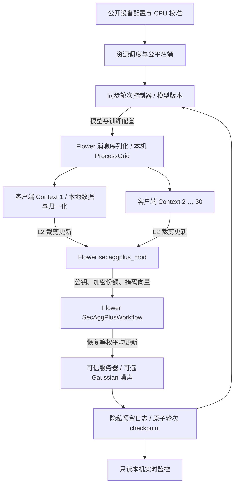

# Zhou Guanxu：系统实现与交接

本实现对应 proposal 中 ZHOU Guanxu 的联邦编排、资源调度、隐私、安全恢复和监控部分。CAO Jun 的模型研究与真正整数推理部署保持独立接口。原 proposal、`sources/` 文件未修改。

## 架构

- 中央同步、部分参与；30 个逻辑家庭分配给有界工作进程。默认 CPU 可用 1–2 个工作进程；CUDA 固定 1 个进程，避免重复占用显存。
- `ClientApp`、`secaggplus_mod`、`SecAggPlusWorkflow` 来自固定版本 Flower 1.23.0。`ProcessGrid` 实现工作流使用的同步接口，经 multiprocessing Pipe 传递 Flower protobuf；没有重写掩码密码协议。
- 一个工作进程可容纳多个逻辑客户端，独立保存 Context。协调进程不接收客户端状态、归一化参数或未掩码单户更新。进程共享同一操作系统，**不是抵御恶意主机或工作进程串谋的隔离边界**。
- 这是 comprehensive simulation。尚未部署 SuperLink/SuperNode、网络身份认证、TLS、真实无线网络或实物网关；不能把 IPC 测试称为互联网部署测试。

## 数据与训练接口

`data30/` 为 30 户完整实际读数，2012-07-01 至 2013-06-30。每户 8,760 个小时，NPZ 文件共 531,267 字节，manifest 另占 6,864 字节。来源、字段、筛选和 SHA-256 见 manifest；原始说明见 `data/ausgrid_source_notes.pdf`。

保留 GC 一般用电，不包含 CL 或 GG。48 小时历史和 4 个日历特征预测未来 24 小时。每户按时间 70/15/15 切分，只有训练期计算归一化量；本地共 253/55/55 个窗口。数据完整性校验在启动及客户端加载时执行。

共同线格式：2,488 个 FP32 参数，MLP `52→32 ReLU→24`。训练后返回相对下发模型的更新，先 L2 裁剪再送入 SecAgg+。每户权重固定为 1，服务器取等户平均，而非样本数加权。NumPy、PyTorch CPU、CUDA 使用同一参数布局、SGD、随机批次和梯度范数裁剪。GPU 浮点结果允许微小数值差异。

CAO 的后续模型可替换 `engine.py` 的模型、展开和预测接口；改变模型维度后须重跑安全聚合、量化误差、校准和恢复测试，旧 checkpoint 不应继续使用。当前 `model_fp32.npz` 仅保存全局模型，本地归一化仍留在各户。旧版 INT8 仅压缩存储，**未实现 INT8 算子推理**。

## 资源调度

公开档位按 manifest 顺序轮转：算力 0.5/1/2，内存 256/1024/4096 MiB，带宽 1/5/20 Mbps，在线率 .60/.80/.95。这些是仿真假设，不是 Ausgrid 用户设备属性。

独立进程用合成张量测量 CPU NumPy 的 epoch 中位耗时、batch=16/32 耗时、进程 RSS 和张量工作集，记录于 calibration.json。调度用该公开 CPU 参照校准；即使主机选择 CUDA，也不把 GPU 速度外推成边缘速度。内存估算使用参照 RSS 与张量工作集的较大值再加 15% 余量，剔除超预算档位。该数值是同机 Python 运行时代理，不等于实测嵌入式峰值内存。

均匀策略与资源策略共享按 `seed,round` 生成的在线、掉线和抖动轨迹。资源策略预留约 1/3 名额给最久未成功贡献的在线户，其余按估算耗时排序。持续离线不能保证参加；公平性用成功覆盖率、贡献次数 Jain 指数和极值衡量。

可选 `--adaptive-epochs` 将低档设为 1 epoch；`--adaptive-batch` 将低档 batch 设为 16。默认关闭，纯调度对照保持训练量相同；组合实验明确标记为两个机制一起改变。

第二轮新增 `--policy cohort`：高、中、低档位逐轮轮换，每轮尽量只选该档位的在线家庭，人数不足时补到安全聚合最低 3 户。这样慢链路集中在部分轮次，且组内优先贡献次数少的家庭。参与上限不变、实际人数可减少；`cohort_matched_uniform` 提供同一轮同样人数的均匀选择对照。原 `resource` 策略继续保留。最新结果与适用限制见 [IMPROVEMENTS.md](IMPROVEMENTS.md)。

`--initial-model artifacts/public_init.npz` 使用另外 20 户公开数据的初始化，检查与联邦家庭不重叠；DP 推荐 C=0.001、σ=4。公开预训练模型、无噪声微调和从头训练分别评估，不能只报告最好的组合。`--evaluation validation` 用于开发阶段，禁止控制器访问测试集。

每个协议阶段逐户统计实际序列化 protobuf 下行/上行字节。模拟网络时间为逐阶段取最慢客户端的载荷/档位带宽，然后累加；加校准训练耗时和掉线截止等待。它不包括 TCP/TLS、重传、真实 RTT、网络排队、操作系统管道开销或密码计算的边缘校准。实际本机 wall time 单独记录，不能与模拟边缘时间混用。验证和最终测试载荷另计，不纳入训练 time-to-target。

## 可靠性

每条 fit 指令包含 round、已提交模型版本和参数 SHA-256。客户端拒绝重放轮次、旧版本或不匹配参数；服务器再次验证回传的公共标签。标签用于防程序错误和陈旧消息，不等于数字签名或恶意服务器防护。

各轮重新生成 SecAgg+ 密钥。模拟掉线发生在密钥分享之后，实际执行份额恢复；人数或份额不足则丢弃该轮，模型版本和隐私发布计数不变。挂起的工作进程导致控制器停止，避免复用不确定协议状态。

checkpoint 包含全局模型、已完成轮次、贡献计数、公平性状态、历史与隐私计数，使用临时文件、fsync、原子替换。恢复前核验配置、公开校准和数据 manifest 指纹及文件哈希。输出目录有 OS 文件锁，阻止两个控制器同时写入。

每次构造 DP 模型之前先持久化隐私计数预留。崩溃后取 checkpoint 和预留日志中的较大计数，已预留但未完成发布也扣预算。恢复只从最近已提交轮次重启，未完成轮次重新交换密钥；不恢复密码秘密或噪声随机状态。

## 已完成与边界

| Zhou 的工作 | 已落地内容 | 使用边界 |
|---|---|---|
| 联邦编排 | Flower 客户端、工作流、同步轮次、等户聚合 | 单机 ProcessGrid |
| 安全聚合 | 真实 SecAgg+、掉线份额恢复、阈值失败中止 | 诚实客户端/服务器，不覆盖恶意客户端投毒 |
| 隐私会计 | L2 裁剪、量化修正敏感度、Gaussian、RDP、预算停止 | 保护模型发布，见 PRIVACY.md |
| 硬件感知 | CPU 校准、内存筛选、公平名额、可选 epoch/batch | 设备与网络仍为模拟档位 |
| GPU | PyTorch CUDA 后端和 30 户验证 | 小 MLP 的 GPU 实测更慢 |
| 恢复 | 原子 checkpoint、配置校验、目录锁、崩溃预算预留 | 从轮次边界恢复 |
| 监控 | 本机 HTTP 实时轮询，训练/聚合/预算/通信/公平性 | 只读，不远程控制训练 |
| 评估 | 10/30 户、3 种子、54 行结果、24 项测试；GPU 30 轮 | 探索性结果；不把目标当成已达成 |

正式课程交付还需要将团队最终模型/部署工作合并、确认数据集替换获认可、形成团队最终报告与演示。此代码不能替代两位成员对实现和结果的理解。
